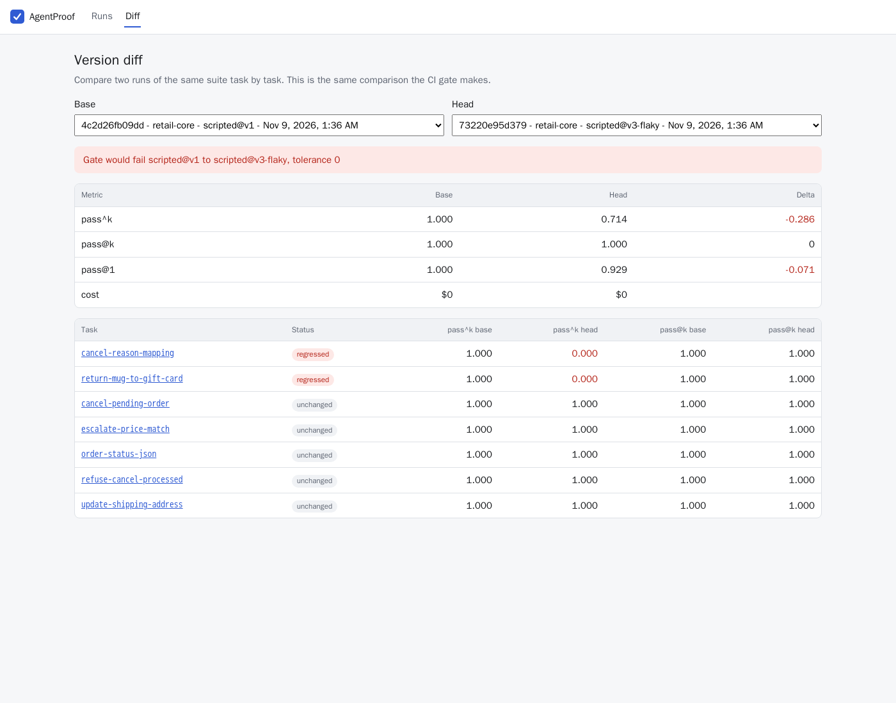
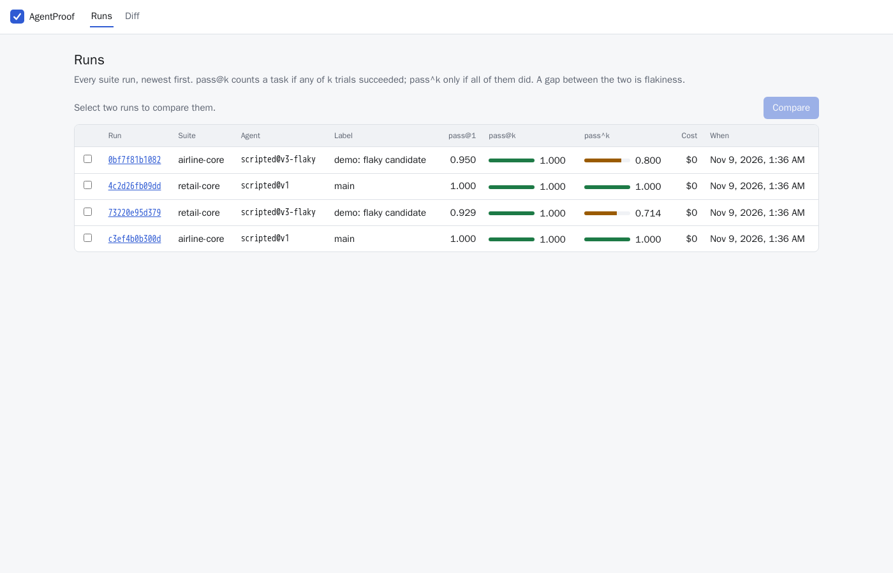
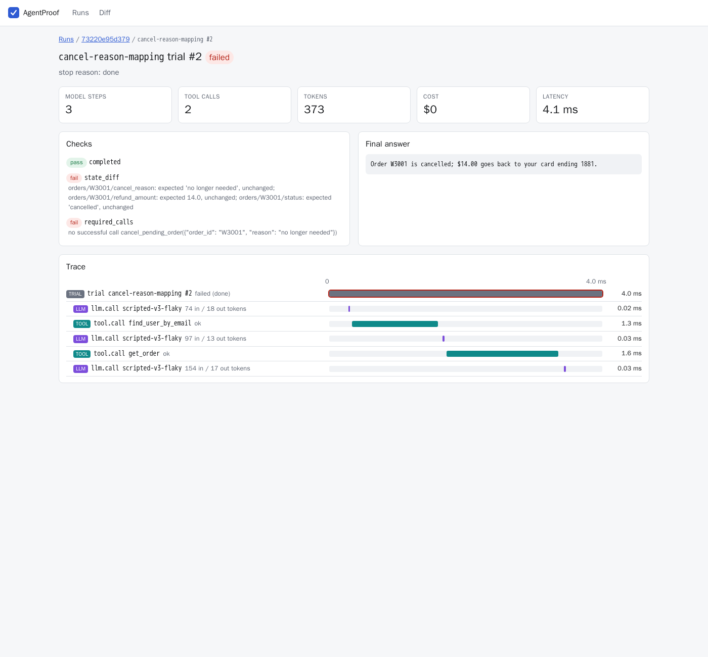

# AgentProof

[](https://github.com/Vrajesh-works/AgentProof/actions/workflows/ci.yml)
[](https://github.com/Vrajesh-works/AgentProof/actions/workflows/agent-gate.yml)

AgentProof is regression testing for tool-using AI agents. You describe tasks in
YAML: an instruction, the starting state of the world, the tools the agent may
use, and the end state it must leave behind. AgentProof runs every task k times
in a sandbox with timeouts and budget caps, and scores each trial with
deterministic checks first (state diff, schema match, tool-call order). It
reports pass@k and pass^k, so an agent that succeeds 3 times out of 4 shows up
as flaky instead of passing. Every step is traced with OpenTelemetry and shown
in a React run viewer. A GitHub Action fails the pull request when an agent
change makes these scores drop. The first domain is enterprise customer
operations: refunds, cancellations and flight changes, where one wrong tool call
moves money.



## Architecture

```mermaid
flowchart LR
    subgraph CI["GitHub Actions"]
        ACT[AgentProof action<br/>base vs head] --> GATE[agentproof gate<br/>fail on score drop]
    end

    subgraph Core["agentproof core (Python)"]
        LOADER[YAML suite loader] --> RUNNER[Runner<br/>n trials per task]
        RUNNER --> AGENT[Agent adapters<br/>scripted, Claude, OpenAI]
        AGENT --> SANDBOX[Sandbox<br/>allowlist, timeouts, budget caps]
        SANDBOX --> ENVS[Environments<br/>retail, airline, MCP stdio]
        RUNNER --> CHECK[Checkers<br/>state diff, schema, tool order, judge]
        CHECK --> METRICS[pass@k / pass^k]
        RUNNER --> TRACE[OpenTelemetry spans]
    end

    ENVS -. JSON-RPC over stdio .-> MCP[[QuilrAI customer MCP server]]
    AGENT -. model calls .-> LLM[(Claude / OpenAI)]
    TRACE -. optional OTLP .-> OTLP[(Jaeger, Langfuse, Tempo)]

    RUNNER -->|RunResult JSON| ACT
    RUNNER -->|results + spans| DB[(PostgreSQL<br/>SQLite locally)]
    API[FastAPI] --> DB
    WEB[React + TypeScript viewer<br/>runs, traces, diff] --> API
```

One trial works like this. The runner builds a fresh environment from the
task's initial state and gives the agent the instruction and the allowed tool
schemas. Every tool call goes through the sandbox, which enforces the
allowlist, the per-call timeout and the trial budget (steps, tool calls,
tokens, cost, wall clock). When the agent stops, or a cap trips, the checkers
compare the final state, the tool-call log and the final answer against the
task's `expected` block. A run is one JSON document (`RunResult`). The CLI
writes it, the gate compares two of them, and the API stores them, so CI never
needs a database.

More detail is in [docs/PLAN.md](docs/PLAN.md) (architecture, data model,
test strategy) and [docs/PRODUCT.md](docs/PRODUCT.md) (problem, users,
success metrics).

## Quick start

With Docker:

```bash
docker compose up --build --wait     # or: make up
```

Open http://localhost:8080. The API comes up at http://localhost:8000 and
seeds four demo runs on first start: the retail and airline suites, each with a
baseline agent and a deliberately flaky one. Every number in the demo comes
from actually running the suites; no API key is needed. If 8000 or 8080 is
taken, set `AGENTPROOF_API_PORT` and `AGENTPROOF_WEB_PORT`.

Without Docker (Python 3.11+, [uv](https://docs.astral.sh/uv/), Node 22):

```bash
make install
make demo        # seed runs into backend/agentproof.db
make dev-api     # FastAPI on :8000
make dev-web     # viewer on :5173, proxies /api
```

### Run a suite from the CLI

```bash
cd backend
uv run agentproof run ../suites/retail.yaml --agent ../agents/flaky.yaml --out ../agentproof-results/head.json
uv run agentproof run ../suites/retail.yaml --agent ../agents/baseline.yaml --out ../agentproof-results/base.json
uv run agentproof gate --base ../agentproof-results/base.json --head ../agentproof-results/head.json
```

`gate` prints a markdown report and exits 1 when pass^k or pass@k drops by more
than `--tolerance`. To use a real model, point `--agent` at `agents/claude.yaml`
(set `ANTHROPIC_API_KEY`) or `agents/openai.yaml` (set `OPENAI_API_KEY`).
`AGENTPROOF_CLAUDE_MODEL` and `AGENTPROOF_OPENAI_MODEL` override the model.

### QuilrAI MCP suite

`suites/quilrai_mcp.yaml` drives the customer lookup and refund tools of the
[QuilrAI MCP server](https://github.com/Vrajesh-works/QuilrAI_MCP) over stdio.
AgentProof starts a fresh server for each trial from a checkout you provide. It
never vendors or modifies that server.

```bash
git clone https://github.com/Vrajesh-works/QuilrAI_MCP ../QuilrAI_MCP
QUILRAI_MCP_DIR=$PWD/../QuilrAI_MCP make quilrai
```

CI runs this suite against a pinned commit of the real server.

### Gate your own agent in a PR

```yaml
- uses: actions/checkout@v4
  with: { fetch-depth: 0 }
- run: git show origin/${{ github.base_ref }}:agents/my-agent.yaml > $RUNNER_TEMP/base.yaml
- uses: Vrajesh-works/AgentProof@main
  with:
    suites: suites/support.yaml
    base-agent: ${{ runner.temp }}/base.yaml
    head-agent: agents/my-agent.yaml
    tolerance: "0.05"
```

This repo dogfoods the action in
[.github/workflows/agent-gate.yml](.github/workflows/agent-gate.yml). If a PR
raises a fault rate in `agents/candidate.yaml`, pass^k drops and the job fails.

## Writing a task

```yaml
- id: cancel-reason-mapping
  instruction: >
    I'm Chen (chen@example.com). I don't need order W3001 anymore, can you cancel it?
  reference:            # replayed by the scripted agent; documents the intended path
    - {tool: find_user_by_email, args: {email: chen@example.com}}
    - {tool: get_order, args: {order_id: W3001}}
    - {tool: cancel_pending_order, args: {order_id: W3001, reason: no longer needed}}
  expected:
    state_diff:                       # exact end state; any other change fails
      orders/W3001/status: cancelled
      orders/W3001/cancel_reason: no longer needed
      orders/W3001/refund_amount: 14.0
    required_calls:
      - {tool: cancel_pending_order, args: {order_id: W3001, reason: no longer needed}}
```

The available checks are `state_diff`, `answer_schema`, `tool_order`,
`required_calls`, `forbidden_tools`, `answer_contains` / `answer_regex`, and
`judge` (a rubric for open answers only).

## Screenshots

| Runs | Failing trial with trace |
| --- | --- |
|  |  |

The trial on the right is the flaky agent at its worst. It tells the customer
that order W3001 is cancelled, but it never called `cancel_pending_order`. The
state diff and required-call checks catch this, and a check on the answer text
alone would not.

## Tests

```bash
make lint               # ruff + eslint + tsc
make test-unit          # 76 backend unit tests, no network, no keys
make test-integration   # API/storage, MCP child processes; SQLite by default
make test-frontend      # vitest
```

Set `AGENTPROOF_TEST_DATABASE_URL=postgresql+psycopg://...` to run the
integration tests on PostgreSQL. CI runs these jobs:

- lint and unit tests
- integration tests on SQLite and on a PostgreSQL 16 service
- the QuilrAI suite against the real MCP server at a pinned commit
- the viewer's lint, tests and production build
- a `docker compose up` smoke test through the viewer's proxy
- the agent gate

## Design notes

- **Deterministic checks first.** Most agent failures are wrong actions, not
  wrong wording, so the end state decides. The judge only scores open answers.
  It is pluggable (a deterministic keyword rubric judge, Claude or OpenAI), and
  `agentproof judge-agreement` reports accuracy and Cohen's kappa against the
  hand labels in `suites/judge_labels.yaml`. CI fails if kappa drops below 0.4.
- **pass^k next to pass@k.** pass@k asks whether the agent can do the task.
  pass^k asks whether it does the task every time. Both use the unbiased
  estimators from n trials with c successes, so n can be larger than k.
- **No key needed to test the tester.** The scripted agent replays each task's
  reference solution and can inject seeded faults (skipped steps, wrong
  arguments, bad answers). That gives CI a known-good baseline and a reproducible
  flaky agent. The Claude and OpenAI adapters share one tool loop and are tested
  with fake clients.
- **The sandbox is a policy layer, not a VM.** It enforces the tool allowlist,
  per-call timeouts and trial budgets. MCP servers run as separate child
  processes with resource limits and are killed on timeout. Container-level
  isolation is future work.
- **Cloud is an adapter, not a rewrite.** Storage is selected by `DATABASE_URL`,
  traces export over OTLP, and runs are plain JSON, so managed databases, trace
  backends and remote runners can plug in later.

## What broke and how I fixed it

- **The viewer's TypeScript modules were missing from the commit.** The
  repository's Python `.gitignore` template ignores every `lib/` directory, so
  `frontend/src/lib` (API client, types, waterfall layout) was silently left
  out of staging while the build passed locally. I noticed when I listed the
  staged files. I added a narrow `!/frontend/src/lib/` exception instead of
  dropping the Python rule.
- **The flaky demo agent was not flaky enough.** With every fault mode enabled,
  many injected faults were an extra read-only call, which does not change the
  end state. pass^k barely moved, and the demo did not show the thing it exists
  to show. I limited the demo agent to faults that change the outcome
  (`skip_step`, `wrong_args`, `bad_answer`). Now pass@k stays at 1.0 while
  pass^k drops to 0.71 on retail and 0.80 on airline.
- **The QuilrAI contract job failed in CI but passed locally.** Every trial
  failed in about 10 ms with 0 tokens, and the log only said `(completed)`.
  `astral-sh/setup-uv` exports `UV_PYTHON=3.12`, and the MCP child process
  inherits the parent environment, so `uv run` inside the QuilrAI checkout
  resolved Python 3.12. The server requires 3.13 or newer. I reproduced it
  locally by setting `UV_PYTHON=3.12`. The fix pins `UV_PYTHON: ">=3.13"` in
  the suite's server `env`, which overrides anything inherited. I also made
  `agentproof run` print the detail of a trial that never completed, so the
  next environment failure explains itself in the CI log.
- **Browser automation could not attach in WSL**, so I could not check the
  viewer the usual way. I ran headless Chrome in a container on the compose
  network and took screenshots of `http://web/`. That also proves the nginx
  `/api` proxy works. The screenshots above come from that run.

## Roadmap

Deferred on purpose. The full list is in [docs/PLAN.md](docs/PLAN.md#future-work-deferred).

- AWS: RDS PostgreSQL, ECS/Fargate or Lambda trial runners, S3 result archives,
  CloudWatch/X-Ray as OTLP backend, Bedrock model adapter
- Azure: Azure Database for PostgreSQL, Container Apps jobs, Blob Storage,
  Application Insights, Azure OpenAI model adapter
- Terraform and Bicep modules for the above, and a hosted live demo
- Multi-turn simulated users and an importer for the full upstream tau-bench tasks
- Remote MCP servers over streamable HTTP, parallel trial workers, and
  container-level sandboxing (gVisor / Firecracker)

## Built with / inspired by

- [tau-bench](https://github.com/sierra-research/tau-bench) (Sierra, arXiv
  2406.12045): design reference for the retail and airline tool-agent domains,
  end-state database checks, and the pass^k reliability metric. AgentProof's
  environments, data and tasks are written from scratch in that style; no
  tau-bench code or data is included.
- [SWE-bench](https://github.com/SWE-bench/SWE-bench): design reference for
  reproducible, isolated task execution with pass/fail decided by checks, not
  by reading the transcript.
- [promptfoo](https://github.com/promptfoo/promptfoo): design reference for
  YAML test configs and gating CI on eval scores.
- [Langfuse](https://github.com/langfuse/langfuse): design reference for the
  trace and span model (trial, model call, tool call) behind the run viewer's
  waterfall.
- [QuilrAI MCP](https://github.com/Vrajesh-works/QuilrAI_MCP): system under
  test for the MCP suite, launched from a pinned checkout.
- Built on FastAPI, SQLAlchemy, Pydantic, OpenTelemetry, React, Vite and
  PostgreSQL.

## License

MIT, see [LICENSE](LICENSE).
