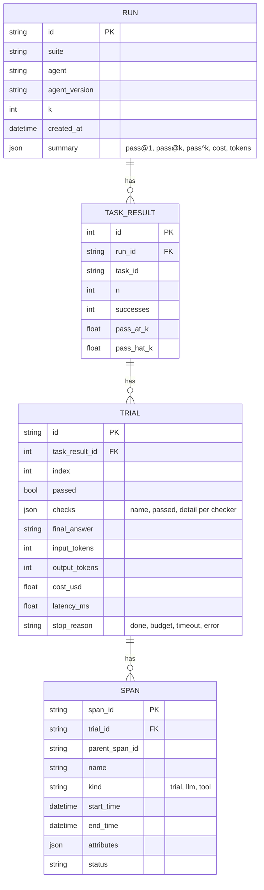

# AgentProof - Technical Plan

## Architecture

```mermaid
flowchart LR
    subgraph CLI["agentproof CLI / GitHub Action"]
        RUN[run] --> GATE[gate / compare]
    end

    subgraph Core["agentproof core (Python)"]
        LOADER[YAML suite loader<br/>pydantic models]
        RUNNER[Runner<br/>k trials per task]
        AGENT[Agent adapters<br/>scripted, Claude, OpenAI]
        SANDBOX[Sandbox<br/>timeouts, budget caps, allowlist]
        ENVS[Environments<br/>retail, airline, MCP stdio]
        CHECK[Checkers<br/>state diff, schema, tool order, judge]
        METRICS[pass@k / pass^k]
        TRACE[OpenTelemetry tracer<br/>span store + optional OTLP]
    end

    subgraph Server["API (FastAPI)"]
        API[/REST: runs, tasks, trials, spans, diff/]
        DB[(PostgreSQL<br/>SQLite for local dev)]
    end

    WEB[React + TypeScript<br/>run viewer and diff view]
    MCP[[QuilrAI customer MCP server<br/>child process, stdio]]
    LLM[(Claude / OpenAI APIs)]

    RUN --> LOADER --> RUNNER
    RUNNER --> AGENT
    AGENT -. model calls .-> LLM
    AGENT --> SANDBOX --> ENVS
    ENVS -. JSON-RPC .-> MCP
    RUNNER --> CHECK --> METRICS
    RUNNER --> TRACE
    RUNNER -->|results + spans| DB
    API --> DB
    WEB --> API
    GATE -->|baseline vs head| METRICS
```

Flow of one trial: the runner builds a fresh environment from the task's
initial state, hands the agent the instruction and the allowed tool schemas,
and lets it act. Every tool call goes through the sandbox, which enforces the
tool allowlist, the per-call timeout, and the trial budget (steps, tool calls,
tokens, cost, wall clock). When the agent finishes (or a cap trips), the
checkers compare the final environment state, the tool-call log, and the
final answer against the task's `expected` block. Spans for the trial, each
model call and each tool call are recorded through OpenTelemetry and saved
with the result.

### Components

| Component | Module | Notes |
| --- | --- | --- |
| Suite loader | `agentproof/suite.py` | Pydantic models for suites, tasks, expectations, budgets; env var interpolation for paths |
| Environments | `agentproof/envs/` | `retail` and `airline` (in-process state + Python tools), `mcp` (stdio JSON-RPC client to a child process) |
| Sandbox | `agentproof/sandbox.py` | Tool allowlist, per-call timeout, trial budget, resource limits for MCP children |
| Agents | `agentproof/agents/` | `Agent` protocol; `ScriptedAgent` (replays reference solutions, seeded fault injection); `ClaudeAgent` and `OpenAIAgent` (env-configured, lazy imports) |
| Checkers | `agentproof/checkers.py` | `state_diff`, `schema`, `tool_order`, `forbidden_tools`, `answer_contains`, `judge` |
| Judge | `agentproof/judge.py` | `Judge` protocol; `RubricKeywordJudge` (deterministic), `LLMJudge` (provider adapter); agreement report vs hand labels |
| Metrics | `agentproof/metrics.py` | Unbiased pass@k and pass^k estimators from n trials with c successes |
| Tracing | `agentproof/tracing.py` | OTel `TracerProvider` with an in-memory exporter that turns spans into rows; optional OTLP exporter via `OTEL_EXPORTER_OTLP_ENDPOINT` |
| Runner | `agentproof/runner.py` | Orchestrates tasks x trials, produces a `RunResult` (JSON-serializable) |
| Gate | `agentproof/gate.py` | Compares two `RunResult`s, renders markdown, returns non-zero on regression |
| Storage | `agentproof/db.py` | SQLAlchemy 2 models; `DATABASE_URL` picks PostgreSQL or SQLite |
| API | `agentproof/api.py` | FastAPI: list/get runs, tasks, trials, spans, diff, import results |
| Viewer | `frontend/` | Vite + React + TypeScript; runs list, run detail, trace waterfall, diff view |

## Data model



A run is also serialized as one JSON document (`RunResult`), which is what the
CLI writes, what the gate compares, and what `POST /api/runs/import` accepts.
That keeps CI independent of a database.

## Task suite format (sketch)

```yaml
suite: retail-core
environment: retail
k: 4
budget: {max_steps: 12, max_tool_calls: 10, max_cost_usd: 0.50, tool_timeout_s: 5}
tasks:
  - id: cancel-pending-order
    instruction: "Cancel order #W1001 for user alice_01, reason: ordered by mistake."
    tools: [find_user, get_order, cancel_pending_order]
    reference:            # used by the scripted agent and as documentation
      - {tool: get_order, args: {order_id: "#W1001"}}
      - {tool: cancel_pending_order, args: {order_id: "#W1001", reason: ordered by mistake}}
    expected:
      state_diff:
        orders."#W1001".status: cancelled
      tool_order: [get_order, cancel_pending_order]
      answer_contains: [cancelled]
```

## Milestones (today)

1. Docs: this plan and `PRODUCT.md`.
2. Core: suite models, retail/airline environments, sandbox, scripted agent,
   checkers, pass@k / pass^k, runner, JSON results, CLI `run`. Unit tests.
3. Tracing: OTel spans per trial / model call / tool call, stored in results.
4. MCP environment: stdio JSON-RPC client with timeouts; a fake customer MCP
   server for tests; QuilrAI suite wired to a user-configured checkout.
5. Gate: `agentproof gate` with markdown summary; composite GitHub Action;
   workflow that gates this repo's own example agent.
6. Storage + API: SQLAlchemy models, FastAPI endpoints, import, diff.
   Integration tests on SQLite locally and PostgreSQL in CI.
7. Viewer: React + TypeScript run list, run detail, trace waterfall, diff.
8. Packaging: Dockerfiles, `docker-compose.yml`, Makefile, CI workflow,
   PR/issue templates, README with diagram and write-ups.
9. Real model adapters (Claude, OpenAI) behind env config, with mocked tests.
10. LLM judge + agreement report against hand labels.

## Test strategy

- **Unit (pytest, no network, no keys):** suite parsing and validation,
  each environment tool, every checker (pass and fail paths), pass@k / pass^k
  against hand-computed values, sandbox timeouts and every budget cap,
  scripted agent determinism, gate comparison logic, judge agreement math.
- **Integration (pytest):** full `run` of the shipped suites with the
  scripted agent; MCP environment against a fake stdio MCP server spawned as a
  real child process (timeouts and crash handling included); API endpoints
  against SQLite and, in CI, PostgreSQL via a service container; the gate CLI
  exiting non-zero on a seeded regression.
- **Contract (CI job):** the QuilrAI suite against the real QuilrAI MCP
  server from a pinned commit, using the scripted agent.
- **Frontend (vitest):** metric formatting, diff computation, waterfall
  layout, and component rendering with mocked API data; `tsc` and production
  build in CI.
- **Smoke (CI job):** `docker compose up`, wait for health, load the demo
  run, hit the API through the viewer's proxy.
- **Adapters:** Claude and OpenAI adapters are tested with fake clients that
  return recorded response shapes, so no key is needed.

## Future work (deferred)

Cloud is out of scope for this version. Each item is designed as an adapter so
it can be added without touching the core:

- **AWS:** RDS PostgreSQL for storage, ECS Fargate or Lambda runners for
  parallel trials, S3 for result archives, CloudWatch / X-Ray as an OTLP
  backend, Bedrock as a model adapter.
- **Azure:** Azure Database for PostgreSQL, Container Apps jobs for runners,
  Blob Storage for results, Application Insights as an OTLP backend, Azure
  OpenAI / Foundry as a model adapter.
- **Infrastructure as code:** Terraform and Bicep modules for the above.
- **Hosted deploy:** public demo deployment of the viewer and API.
- Multi-turn simulated users (tau-bench style user simulator).
- Importer for the full upstream tau-bench task set and data.
- Remote MCP servers over streamable HTTP (only stdio today).
- Parallel trial execution across workers and a job queue.
- Container-level sandboxing (gVisor / Firecracker) for untrusted tool code.
- Auth, projects, and multi-tenant access control on the API.
